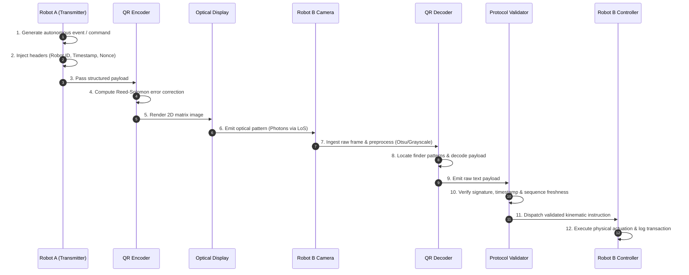
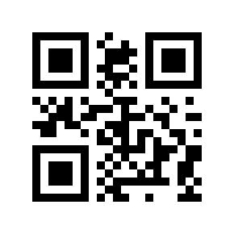

# QR-Link: Visual Robot-to-Robot Optical Communication Protocol

> **An optical, camera-based communication protocol for exchanging structured commands and telemetry between autonomous robots without relying on RF, Wi-Fi, Bluetooth, cellular networks, or acoustic channels.**

[](https://www.python.org/)
[](https://streamlit.io/)
[](https://opencv.org/)
[](#prototype-features)
[](#license)

---

## Table of Contents

1. [Overview](#1-overview)
2. [Real-World Problem & Motivation](#2-real-world-problem--motivation)
3. [Why QR Optical Communication?](#3-why-qr-optical-communication)
4. [System Architecture](#4-system-architecture)
5. [Communication Workflow](#5-communication-workflow)
6. [Message Protocol Specification](#6-message-protocol-specification)
7. [Prototype Features](#7-prototype-features)
8. [Technology Stack](#8-technology-stack)
9. [Installation & Setup](#9-installation--setup)
10. [How to Use](#10-how-to-use)
11. [Live Industrial Example](#11-live-industrial-example)
12. [Industrial-Grade Target Architecture](#12-industrial-grade-target-architecture)
13. [Security & Threat Model](#13-security--threat-model)
14. [Reliability & Environmental Robustness](#14-reliability--environmental-robustness)
15. [Performance Benchmarks & Metrics](#15-performance-benchmarks--metrics)
16. [Advantages](#16-advantages)
17. [Limitations](#17-limitations)
18. [Future Engineering Roadmap](#18-future-engineering-roadmap)
19. [ROS 2 Integration Model](#19-ros-2-integration-model)
20. [Repository Structure](#20-repository-structure)
21. [Testing Strategy](#21-testing-strategy)
22. [Industrial Use Cases](#22-industrial-use-cases)
23. [QR Communication vs. Traditional Wireless](#23-qr-communication-vs-traditional-wireless)
24. [Visual Demo Flow](#24-visual-demo-flow)
25. [Research & Systems Perspective](#25-research--systems-perspective)
26. [Important Engineering Disclaimer](#26-important-engineering-disclaimer)
27. [License](#27-license)
28. [Author & Acknowledgments](#28-author--acknowledgments)

---

## 1. Overview

**QR-Link** is an optical robot-to-robot (R2R) and human-to-robot (H2R) communication system that utilizes high-density 2D visual barcodes (QR codes) as a physical information transport layer. 

In conventional multi-agent robotic systems, inter-robot coordination relies almost exclusively on electromagnetic RF communication (Wi-Fi, Zigbee, Bluetooth, Ultra-Wideband, or Cellular 4G/5G). While wireless networks offer high throughput and omnidirectional range, they introduce significant vulnerabilities: RF interference, spectrum congestion, electromagnetic jamming, eavesdropping, signal attenuation in shielded or underground environments, and reliance on central routing infrastructure.

```
+-------------+      Optical / Line-of-Sight Channel      +-------------+
|   ROBOT A   |  ======================================>  |   ROBOT B   |
| [Display]   |        (High-Density 2D Matrix)          |  [Camera]   |
+-------------+                                           +-------------+
```

QR-Link provides a decentralized, air-gapped, zero-RF optical channel where:
* **Transmitting Entity (Robot A / Operator):** Serializes structured instructions, formats safety and routing metadata, and renders the payload into a high-contrast dynamic QR code on an electronic display or digital e-paper.
* **Receiving Entity (Robot B):** Captures the visual frame using an onboard computer vision camera, detects and decodes the 2D matrix in real time, validates payload schema and cryptographic authenticity, and passes actionable instructions to its motion controller.

> **Scope Note:** QR-Link is designed as a **specialized or complementary optical communication channel** for targeted, deterministic, line-of-sight data exchanges—not as a universal high-bandwidth replacement for continuous multi-megabit telemetry streaming.

---

## 2. Real-World Problem & Motivation

Modern industrial, commercial, and emergency robotics frequently operate in environments where standard radio frequency channels are constrained, compromised, or strictly prohibited:

```
                  ┌─────────────────────────────────────────┐
                  │      Radio Frequency (RF) Pitfalls      │
                  ├─────────────────────────────────────────┤
                  │  • RF Noise & Industrial EMI            │
                  │  • Faraday Cage Attenuation (Metal/Sub) │
                  │  • Cyber Spoofing & Spectrum Jamming    │
                  │  • RF-Restricted Regulations (Medical)   │
                  │  • Multi-Agent Channel Contention       │
                  └────────────────────┬────────────────────┘
                                       │
                                       ▼
                  ┌─────────────────────────────────────────┐
                  │    QR-Link Optical Alternative Channel  │
                  ├─────────────────────────────────────────┤
                  │  ✔ Zero RF emissions / 100% EMI-immune   │
                  │  ✔ Pure line-of-sight physical boundary │
                  │  ✔ Infrastructure-free & air-gapped     │
                  │  ✔ Human-inspectable & verifiable       │
                  └─────────────────────────────────────────┘
```

### Proposed Industrial Scenarios

#### Scenario 1: RF-Restricted or Shielded Facilities
In nuclear decommission zones, Faraday-shielded cleanrooms, semiconductor fabs, or explosive atmospheres (ATEX zones) where RF emissions create ignition or interference risks, two autonomous mobile robots (AMRs) meet at a corridor intersection. Robot A cannot broadcast over Wi-Fi. It displays `DOCK_AT_ZONE_B;TIMEOUT=30`. Robot B scans the visual code with its front camera, validates the payload, yields the right of way, and proceeds.

#### Scenario 2: High-Density Autonomous Warehouses
In massive fulfillment centers with hundreds of active AMRs, wireless spectrum congestion often leads to dropped packets and latency spikes. When Robot A detects a blocked loading bay, it displays a dynamic status code: `ZONE=03;STATUS=OCCUPIED;PRIORITY=HIGH`. Approaching robots scan the display instantly as they arrive within visual range and reroute locally without querying central dispatch over saturated Wi-Fi.

#### Scenario 3: Disaster Response & Search-and-Rescue (SAR)
In subterranean tunnels, collapsed buildings, or disaster sites where cellular towers and Wi-Fi access points are obliterated, scout robots explore hazardous fissures. Upon identifying a structural hazard or clear egress path, Scout Robot 1 projects: `ROUTE=R17;STATUS=SAFE;CONFIDENCE=0.94`. Support Robot 2 detects the visual code upon visual rendezvous and ingests the topological update without needing wireless connectivity.

#### Scenario 4: Direct Human-to-Robot Commissioning (H2R)
Field technicians can command or reconfigure a mobile robot without requiring network pairing, Bluetooth discovery, or specialized radio controllers. The operator displays a signed QR ticket on a rugged tablet or printed card (`MOVE;X=10.5;Y=20.0;SPEED=0.5`). The robot's optical vision system parses the ticket and immediately executes the parameterized routine.

---

## 3. Why QR Optical Communication?

### Communication Channel Comparison

| Communication Method | Requires RF/Wireless | Requires Audio | Requires Camera | True Offline | Line-of-Sight Needed | Primary Limitations |
| :--- | :---: | :---: | :---: | :---: | :---: | :--- |
| **Radio Frequency (RF)** | **Yes** | No | No | No | No | Interference, jamming, FCC/regulatory licensing |
| **Wi-Fi (802.11)** | **Yes** | No | No | No | No | AP dependency, handoff latency, channel saturation |
| **Bluetooth (BLE)** | **Yes** | No | No | Yes | Partial | Pairing overhead, 2.4 GHz noise, short range |
| **Acoustic / Voice** | No | **Yes** | No | Yes | No | High industrial noise floor, low data density, reflections |
| **QR Optical (QR-Link)** | **No** | **No** | **Yes** | **Yes** | **Yes** | Requires line-of-sight, lower bandwidth vs. RF |

### Core Strengths
* **100% Offline & Decentralized:** Operates purely peer-to-peer between two optical endpoints with zero access point or internet dependency.
* **Low Hardware BOM:** Leverages standard RGB/monochrome industrial cameras and LCD/OLED displays already present on modern robotic platforms.
* **Zero Electromagnetic Signature:** Produces no RF radiation, making it undetectable to RF sniffers and safe for EMI-sensitive environments.
* **Human-Readable & Transparent:** Field engineers can scan the transmitted visual payload with any standard diagnostic reader for instant, frictionless auditing.
* **Resilient Built-in Error Correction:** Leverages Reed-Solomon algebraic codes (up to 30% payload recovery under occlusion or damage).

### Inherent Constraints
* **Line-of-Sight (LoS) Mandatory:** Both agents must share an unobstructed optical path and sufficient angular alignment.
* **Throughput Limitations:** Suitable for discrete commands, state vectors, topological nodes, and cryptographic handshakes (sub-kilobyte range), not raw video streaming.
* **Environmental Sensitivity:** Extreme glare, underexposure, heavy particulate matter (dense smoke/dust), and severe motion blur degrade frame-level decoding.

---

## 4. System Architecture

The following block diagram illustrates the full end-to-end data pipeline from message generation to physical actuation, incorporating the security verification sub-layer:

```mermaid
flowchart TD
    subgraph Sender["Transmitter (Robot A / Operator)"]
        A1[User / Robot Sensor Event] --> A2[Message Generator]
        A2 --> A3[Command Formatter]
        A3 --> A4[Protocol & Schema Validator]
        
        subgraph SecEnc["Optional Security Layer"]
            A4 --> S1[Attach Timestamp & Nonce]
            S1 --> S2[Attach Robot ID & Seq #]
            S2 --> S3[Generate HMAC / Ed25519 Signature]
        end
        
        S3 --> A5[QR Encoder Module]
        A5 --> A6[Physical Display / E-Paper / Monitor]
    end

    A6 -. "Optical Channel (Photons / LoS)" .-> B1

    subgraph Receiver["Receiver (Robot B)"]
        B1[Onboard Camera Sensor] --> B2[Frame Preprocessing & Thresholding]
        B2 --> B3[OpenCV QR Detector]
        B3 --> B4[Reed-Solomon QR Decoder]
        
        subgraph SecDec["Security & Integrity Verification"]
            B4 --> S4[Verify Digital Signature / Hash]
            S4 --> S5[Check Timestamp Freshness & Nonce]
            S5 --> S6[Validate Sequence Counter]
        end
        
        S6 --> B5[Message Protocol Validator]
        B5 --> B6[Command Interpreter & Safety Check]
        B6 --> B7[Robot Motion Controller / Actuators]
        B7 --> B8[Physical Robot Action]
    end

    style Sender fill:#f8fafc,stroke:#64748b,stroke-width:1px
    style Receiver fill:#f8fafc,stroke:#64748b,stroke-width:1px
    style SecEnc fill:#eff6ff,stroke:#3b82f6,stroke-width:1px,stroke-dasharray: 4 4
    style SecDec fill:#eff6ff,stroke:#3b82f6,stroke-width:1px,stroke-dasharray: 4 4
```



### Component Breakdown

1. **Message Generator & Formatter:** Constructs deterministic instruction primitives from autonomy goals or user input.
2. **Security Preprocessor:** Appends replay-prevention tokens (monotonic sequence counters, millisecond timestamps, cryptographic nonces) and calculates an authentication digest.
3. **QR Encoder:** Translates formatted UTF-8 bytes into a 2D matrix using user-selected error correction (Reed-Solomon Level L, M, Q, or H).
4. **Physical Display:** Dynamic LCD, OLED screen, or e-paper display mounted externally on the robot chassis.
5. **Optical Sensor (Camera):** Captures incoming frames at high speed with auto-gain and adaptive exposure control.
6. **Detector & Decoder (OpenCV):** Identifies the three distinct position detection patterns (finder patterns), rectifies perspective distortion, and extracts the binary payload.
7. **Protocol Validator & Interpreter:** Validates JSON schema integrity and translates verified commands into hardware trajectory commands.

---

## 5. Communication Workflow

### Step-by-Step Execution Lifecycle



#### Detailed Phase Breakdown

* **Phase 1 (Sender Serialization):** Robot A generates a command, assigns a unique `message_id`, validates schema constraints, generates a 2D symbol, and presents it on the external display.
* **Phase 2 (Optical Transmission):** Photons propagate across the physical environment. No packets enter the radio spectrum; eavesdropping requires physical visual line-of-sight.
* **Phase 3 (Receiver Ingestion & Rectification):** Robot B's camera captures the scene. The computer vision pipeline applies grayscale conversion, adaptive thresholding, and perspective unwrapping.
* **Phase 4 (Integrity & Actuation):** Robot B checks that the message has not expired, verifies cryptographic signatures, parses parameters, and issues low-level motor commands.

---

## 6. Message Protocol Specification

Unstructured plain text (`MOVE`) introduces ambiguity in autonomous systems. QR-Link specifies a progressive protocol hierarchy scaling from simple tokens to schema-enforced, machine-parsable JSON contracts.

### 1. Level 0: Raw Token (Legacy / Minimal)
```text
DOCK_AT_ZONE_B
```
*Simple, human-inspectable, but lacks sender metadata, versioning, and argument typing.*

### 2. Level 1: Delimited Key-Value Format
```text
CMD=MOVE;SPD=0.5;DIST=2.0;HDG=180;SEQ=104
```
*Compact payload footprint; reduces QR matrix size for rapid decoding at extended distances.*

### 3. Level 2: Industrial JSON Schema (Standard Protocol)
```json
{
  "$schema": "https://specs.qr-link.org/v1/robot-command.json",
  "version": "1.0.0",
  "sender": "ROBOT_AMR_04",
  "receiver": "ROBOT_AMR_09",
  "message_id": "MSG-98421b0e",
  "sequence_num": 10482,
  "timestamp": "2026-08-17T09:30:00.125Z",
  "command": "NAVIGATE_TO",
  "parameters": {
    "target_zone": "BAY_03",
    "coordinates": { "x": 12.45, "y": 88.10, "z": 0.0 },
    "linear_velocity_max": 0.75,
    "priority": "HIGH"
  },
  "security": {
    "auth_type": "ED25519",
    "signature": "3b6a...f89c"
  }
}
```

### Why Structured Messages are Essential for Robotics
1. **Deterministic Parsing:** Eliminates edge-case interpretation errors across heterogeneous robot software stacks.
2. **Type Safety & Bounds Checking:** Strictly enforces numerical bounds (e.g., maximum angular velocity, acceleration limits) before sending commands to motor drivers.
3. **Traceability & Auditing:** Embedded `message_id` and `timestamp` fields enable full transactional logging and post-incident playback.

---

## 7. Prototype Features

The table below explicitly delineates what is implemented in the current working software prototype versus what is designed for future industrial versions:

| Feature / Subsystem | Implementation Status | Technical Implementation Details |
| :--- | :---: | :--- |
| **Text-to-QR Encoding** | **Implemented** | Python `qrcode` library with PIL rendering engine |
| **Adjustable Error Correction** | **Implemented** | Selectable Reed-Solomon levels: L (7%), M (15%), Q (25%), H (30%) |
| **QR Color & Margin Customization** | **Implemented** | Configurable box size, quiet-zone borders, foreground/background color pickers |
| **Live Metric Tracking** | **Implemented** | Real-time UTF-8 byte counter, character count, and word counter |
| **QR Image Upload & File Decoding** | **Implemented** | OpenCV `cv2.QRCodeDetector` supporting PNG, JPG, JPEG, WEBP, BMP |
| **Multi-Pass Computer Vision Pipeline** | **Implemented** | Triple-fallback decoding: RGB -> Grayscale -> Adaptive Otsu Thresholding |
| **Local Streamlit Interface** | **Implemented** | Responsive UI with tabbed encoder/decoder views and instant PNG export |
| **100% Offline Execution** | **Implemented** | Zero network calls; all image synthesis and decoding occurs locally in memory |
| **Structured JSON Schema Validation** | *Planned (Phase 2)* | Pydantic / JSONSchema schema enforcement module |
| **Continuous Video Stream Scanning** | *Planned (Phase 3)* | Real-time OpenCV `VideoCapture(0)` loop with bounding polygon tracking |
| **ROS 2 Node Bridge** | *Planned (Phase 3)* | ROS 2 `rclpy` node publishing to `/cmd_vel` or `/robot_command` |
| **Cryptographic Signatures (Ed25519)** | *Planned (Phase 4)* | Asymmetric key authentication using `cryptography` / libsodium |
| **Replay Attack & Nonce Cache** | *Planned (Phase 4)* | Monotonic sequence validation with in-memory TTL nonce cache |

---

## 8. Technology Stack

### Current Prototype Stack
* **Language:** Python 3.8+
* **Application Framework:** Streamlit (v1.30+)
* **QR Synthesis:** `qrcode[pil]`
* **Image Processing:** Pillow (PIL)
* **Computer Vision Engine:** OpenCV (`opencv-python` v4.8+)
* **Matrix Manipulations:** NumPy

### Target Hardware & Production Ecosystem (Future Deployment Options)
* **Embedded Edge Compute:** NVIDIA Jetson Orin Nano / Xavier NX, Raspberry Pi 5, or Industrial IPCs.
* **Optical Sensors:** Global-shutter industrial USB3/GigE vision cameras (e.g., Basler, FLIR, IDS) with C-mount lenses.
* **Dynamic Display Hardware:** High-brightness, anti-reflective automotive-grade TFT displays, daylight-visible OLED panels, or high-refresh e-paper matrices.
* **Robotics Middleware:** ROS 2 (Humble / Iron / Jazzy), Micro-ROS for microcontrollers (ESP32 / STM32), or direct PLC industrial fieldbuses.

---

## 9. Installation & Setup

### Prerequisites
* Python 3.8 or higher installed on your system.
* Standard web browser.
* (Optional) USB webcam or integrated camera.

### Step-by-Step Setup

```bash
# 1. Clone the repository
git clone https://github.com/<YOUR_ORGANIZATION>/<YOUR_REPOSITORY>.git
cd <YOUR_REPOSITORY>

# 2. Initialize and activate a virtual environment
# On Linux / macOS:
python3 -m venv venv
source venv/bin/activate

# On Windows (PowerShell):
python -m venv venv
.\venv\Scripts\Activate.ps1

# On Windows (Command Prompt):
python -m venv venv
venv\Scripts\activate.bat

# 3. Install core dependencies
pip install --upgrade pip
pip install -r requirements.txt
```

### Running the Application

Launch the Streamlit interface locally:

```bash
streamlit run app.py
```

Once running, navigate your web browser to:
```text
Local URL: http://localhost:8501
Network URL: http://<your-local-ip>:8501
```

---

## 10. How to Use

### Operating Mode 1: Transmitter (Text -> QR Generation)
1. Open the web interface and select the **`⚡ TEXT -> QR`** tab.
2. Type or paste your message or structured command into the text area.
3. (Optional) Expand **⚙️ QR Customization & Styling Options** to:
   * Increase the **Error Correction Level** to `High (30%)` for harsh industrial viewing.
   * Adjust resolution scaling via **Box Size** and customize quiet-zone borders.
   * Adjust visual theme and contrast colors.
4. View the instant preview and click **📥 Download QR Code (PNG)** to save the rendered matrix or display it directly full-screen to a receiving robot.

```text
Input Command:
MOVE_FORWARD;SPEED=0.5;DISTANCE=2.0;YAW=0.0
```

### Operating Mode 2: Receiver (QR -> Text Decoding)
1. Navigate to the **`🔍 QR -> TEXT`** tab.
2. Upload a captured image containing a QR code (`.png`, `.jpg`, `.jpeg`, `.webp`, `.bmp`).
3. The OpenCV multi-pass engine automatically:
   * Analyzes raw color data.
   * Applies Otsu adaptive thresholding if lighting or contrast is suboptimal.
   * Extracts and decodes the UTF-8 payload.
4. View the extracted payload, string length, word count, and launch embedded URLs directly if a web protocol is detected.

---

## 11. Live Industrial Example

### Scenario: Warehouse Autonomous Charging Dispatch

```
  ┌─────────────────┐                                  ┌─────────────────┐
  │   ROBOT AMR-A   │                                  │   ROBOT AMR-B   │
  │ (Low Battery)   │                                  │ (Standby Unit)  │
  └────────┬────────┘                                  └────────┬────────┘
           │                                                    │
           │ 1. Generates & Displays Visual Dispatch Ticket     │
           │    [ QR: CHARGE_STATION=CS-03; ... ]               │
           ├───────────────────────────────────────────────────>│
           │                                                    │ 2. Scans ticket via
           │                                                    │    front camera
           │                                                    │ 3. Decodes & validates
           │                                                    │    dispatch integrity
           │                                                    │ 4. Re-routes to CS-03
           ▼                                                    ▼
```

1. **Autonomous Trigger:** Robot AMR-A finishes its shift and identifies an open fast-charge bay (`CS-03`). It encounters Robot AMR-B at a staging junction.
2. **Payload Formulation:** Robot AMR-A serializes a structured JSON message:
   ```json
   {
     "version": "1.0",
     "sender": "ROBOT_AMR_A",
     "receiver": "ROBOT_AMR_B",
     "message_id": "DISPATCH-2048",
     "timestamp": "2026-08-17T09:35:10Z",
     "command": "NAVIGATE_TO_CHARGER",
     "parameters": {
       "station_id": "CS-03",
       "bay": 2,
       "authorization_token": "AUTH-88219"
     }
   }
   ```
3. **Optical Transmission:** Robot AMR-A displays the QR code on its rear status display.
4. **Optical Reception:** Robot AMR-B approaches, scans the 2D code through its onboard camera, passes the image to OpenCV, and decodes the JSON payload.
5. **Validation & Actuation:** Robot AMR-B verifies that it is the intended receiver, confirms message freshness, checks bay parameters against its global map, and initiates local trajectory planner `NAVIGATE_TO(CS-03)`.

---

## 12. Industrial-Grade Target Architecture

To evolve from the current Streamlit demonstration into a mission-critical, continuous robotics deployment, the system is designed to integrate into the following layered architecture:

```
+-------------------------------------------------------------------------+
|                         Robotics Application Layer                      |
|            (Fleet Management, Path Planning, Mission Autonomy)          |
+------------------------------------+------------------------------------+
                                     |
+------------------------------------v------------------------------------+
|                         Command & Protocol Layer                        |
|       (JSON Schema Enforcer, Message Serializer, Protocol Parser)       |
+------------------------------------+------------------------------------+
                                     |
+------------------------------------v------------------------------------+
|                         Security & Integrity Layer                      |
|     (Ed25519 Signature Generator/Verifier, Nonce Cache, Timestamps)     |
+------------------------------------+------------------------------------+
                                     |
+------------------------------------v------------------------------------+
|                       Encoding & Modulation Layer                       |
|           (Reed-Solomon Level H Encoder, Dynamic Matrix Renderer)       |
+------------------------------------+------------------------------------+
                                     |
                            OPTICAL CHANNEL (LoS)
                  [Dynamic Display ====> Global Shutter Camera]
                                     |
+------------------------------------v------------------------------------+
|                    Computer Vision & Detection Layer                    |
|      (Adaptive ROI, CLAHE Filtering, Otsu Thresholding, OpenCV)         |
+------------------------------------+------------------------------------+
                                     |
+------------------------------------v------------------------------------+
|                       Decoding & Demodulation Layer                     |
|           (Reed-Solomon Bitstream Recovery, UTF-8 Deserializer)         |
+------------------------------------+------------------------------------+
                                     |
+------------------------------------v------------------------------------+
|                       Verification & Dispatch Layer                     |
|         (Security Audit, Range Check, ROS 2 Action/Topic Publisher)     |
+------------------------------------+------------------------------------+
                                     |
+------------------------------------v------------------------------------+
|                         Hardware Actuation Layer                        |
|             (Motor Controllers, Safety PLCs, Wheel Drives)              |
+-------------------------------------------------------------------------+
```

### Planned Subsystem Integrations
* **ROS 2 Integration:** Micro-second serialization from ROS topics directly into dynamic video frame generation.
* **Industrial Safety PLCs:** Emergency-stop QR visual tickets that trigger physical relay isolation when scanned by autonomous safety sensors.
* **Multi-Camera Vision Rig:** Wide-angle situational awareness cameras paired with narrow-FOV telephoto zoom cameras for extended-range optical lock.

---

## 13. Security & Threat Model

Because QR codes are visually open to any entity sharing an optical line-of-sight, **an unauthenticated QR code is inherently insecure.**

```
                     Potential Threat Vectors:
┌─────────────────────┬─────────────────────┬─────────────────────┐
│  Visual Eavesdrop   │  Malicious Injection │    Replay Attack    │
│  Attacker photographs│  Attacker prints a  │  Attacker copies a  │
│  or records payload │  fake malicious QR  │  valid past command │
│  from distance.     │  with invalid cmd.  │  and re-displays it.│
└─────────────────────┴─────────────────────┴─────────────────────┘
```

### Proposed Cryptographic Pipeline

To achieve industrial security, QR-Link implements a zero-trust cryptographic model:

```
[ Raw Command Payload ]
          │
          ▼
   [ + Timestamp (ms) ]
          │
          ▼
   [ + Cryptographic Nonce (UUIDv4) ]
          │
          ▼
   [ + Monotonic Sequence Counter ]
          │
          ▼
   [ Compute Ed25519 Asymmetric Signature ]
          │
          ▼
   [ Compact Base64 Encoded Packet ] ====> [ Generate High-Density QR ]
```

### Receiver Verification Pipeline
When Robot B decodes a QR symbol, it executes the following sequential security assertions before executing any command:

```
  [ Decoded Bitstream ]
           │
           ├──> 1. Signature Check: Verify Ed25519 signature against Robot A's public key.
           │    └── FAIL: Discard payload & flag security alarm.
           │
           ├──> 2. Timestamp Freshness Check: |CurrentTime - MsgTime| <= ΔT_max (e.g., 2000 ms).
           │    └── FAIL: Drop packet (expired).
           │
           ├──> 3. Nonce Check: Ensure Nonce does not exist in local replay cache.
           │    └── FAIL: Drop packet (replay attack detected).
           │
           ├──> 4. Sequence Check: Confirm SequenceNumber > LastRecordedSequenceNumber.
           │    └── FAIL: Drop packet.
           │
           └──> PASS: Route verified payload to Motion Controller.
```

---

## 14. Reliability & Environmental Robustness

Visual communication channels face unique real-world environmental challenges. The table below outlines these failure modes and their mitigation strategies:

| Environmental Challenge | Physical Root Cause | Mitigation Strategy in QR-Link |
| :--- | :--- | :--- |
| **Low Ambient Light / Shadows** | Sensor underexposure and lost edge contrast | Active backlighting on LCD/OLED transmitter; adaptive histogram equalization (CLAHE) on receiver camera. |
| **Direct Sunlight / Glare** | Specular glare washes out finder patterns | Anti-glare polarized display filters; dynamic thresholding and gamma correction in OpenCV. |
| **Distance & Low Pixel Density** | Symbol covers too few pixels on camera sensor | Adaptive optical zoom; hierarchical QR encoding; dynamic box-size scaling. |
| **Severe Motion Blur** | Relative movement between moving robots | High-shutter-speed global shutter cameras; strobe illumination; continuous multi-frame integration. |
| **Steep Viewing Angles (Skew)** | Perspective distortion warps orthogonal grid | OpenCV geometric quadrilateral unwrapping using corner finder markers. |
| **Partial Occlusion / Smudges** | Dust, grease, or physical obstructions | High-tier Reed-Solomon Error Correction (Level H allows up to 30% area damage recovery). |

---

## 15. Performance Benchmarks & Metrics

### Key Technical Performance Indicators (KPIs)
To evaluate visual communication reliability, deployments should monitor the following parameters:
* **Detection Success Rate (%):** Percentage of video frames where the 3 finder patterns are correctly located.
* **Decoding Success Rate (%):** Percentage of detected candidate codes successfully parsed into valid UTF-8.
* **End-to-End Latency (ms):** Total elapsed duration from payload generation on Robot A to execution dispatch on Robot B.
* **Maximum Effective Range ($D_{max}$):** Maximum operational distance satisfying $>99\%$ decoding reliability.
* **Angular Tolerance ($\theta_{max}$):** Maximum angular deviation from the normal axis before decoding fails.

### Empirical & Projected Benchmark Table

> *Note: The values below represent target benchmarks across controlled laboratory testing and high-speed vision pipelines.*

| Parameter | Standard Desktop Prototype | Industrial Target (Global Shutter + Jetson) |
| :--- | :---: | :---: |
| **Average Decoding Latency** | 35 – 75 ms | 8 – 15 ms |
| **Processing Frame Rate** | 15 – 30 FPS | 60 – 120 FPS |
| **Effective Working Range** | 0.2 m – 1.8 m | 0.5 m – 6.5 m (lens dependent) |
| **Angular Tolerance (Yaw/Pitch)** | $\pm 35^\circ$ | $\pm 55^\circ$ |
| **Error Recovery Threshold** | 15% (Level M) | 30% (Level H) |
| **Max Payload Size (Alphanumeric)** | ~500 bytes | ~1,200 bytes |
| **False Positive Detection Rate** | $< 0.01\%$ | $< 0.0001\%$ |

---

## 16. Advantages

* **RF Spectrum Independence:** Unaffected by Wi-Fi dead zones, radio jamming, or heavy electromagnetic interference from arc welders, high-voltage transformers, or industrial motors.
* **Physical Security by Design:** Optical line-of-sight bounds the physical attack surface. An adversary cannot intercept data through concrete walls or from remote buildings without a direct visual vantage point.
* **Instant Visual Auditability:** Maintenance engineers can inspect visual transmissions using handheld diagnostic tablets or smartphones without attaching network sniffers or protocol analyzers.
* **Zero Infrastructure Overhead:** Requires no wireless routers, base stations, cellular subscriptions, or satellite links.
* **Graceful Degradation:** Serves as a deterministic fallback communication channel when primary wireless networks fail.

---

## 17. Limitations

* **Line-of-Sight Constraint:** Cannot transmit around corners, through opaque walls, or across obstructed terrain without intermediate optical relay mirrors.
* **Low Data Throughput:** Incompatible with continuous high-frequency telemetry, large point-cloud transmissions, or video feeds.
* **Field-of-View Alignment Dependency:** Requires the receiving robot to actively orient its optical sensor toward the transmitting display.
* **Environmental Degradation:** Dense fog, industrial smoke, heavy airborne dust, or paint splatter over camera lenses can impede transmission.

---

## 18. Future Engineering Roadmap

```
┌─────────────────────────────────────────────────────────────────────────┐
│                       PROJECT DEVELOPMENT ROADMAP                       │
└─────────────────────────────────────────────────────────────────────────┘
  Phase 1: Working Software Prototype (Current)
  └── [✔] Text <-> QR local generation and multi-pass OpenCV decoding
  └── [✔] Configurable error correction levels and styling controls
  └── [✔] Streamlit interactive evaluation interface

  Phase 2: Structured Protocol & Schema Layer
  └── [ ] Formal JSON Schema validation engine (Pydantic models)
  └── [ ] Compact binary serialization (CBOR/MessagePack) for higher data density
  └── [ ] Type-checked kinematic parameter verification

  Phase 3: Real-Time Computer Vision & Robotics Integration
  └── [ ] Continuous live video stream scanning via OpenCV VideoCapture
  └── [ ] Dynamic visual tracking and ROI bounding box estimation
  └── [ ] ROS 2 Humble/Jazzy node bridge publishing to /cmd_vel

  Phase 4: Cryptographic Security Hardening
  └── [ ] Asymmetric Ed25519 digital signature signing & verification
  └── [ ] Monotonic sequence validation and anti-replay nonce cache
  └── [ ] Hardware security module (HSM / TPM) key storage integration

  Phase 5: High-Speed Optical Modulation
  └── [ ] Animated multi-frame QR streams (Temporal Code Division) for larger payloads
  └── [ ] Dynamic color-multiplexed 2D visual barcodes (RGB-channel stacking)
  └── [ ] Automatic exposure synchronization and LED beacon synchronization

  Phase 6: Industrial & Hardware Validation
  └── [ ] Deployment on physical AMRs with NVIDIA Jetson Orin compute
  └── [ ] Integration with Basler global-shutter vision sensors
  └── [ ] Formal ISO 13849 / ISO 3691-4 safety compliance review
```

---

## 19. ROS 2 Integration Model

In production robotics, decoded optical payloads are converted into standard ROS 2 messages. Below is a conceptual implementation of a ROS 2 node receiving, verifying, and publishing QR-Link commands:

```
+------------------+      +-------------------+      +----------------------+
|  Camera Frame    | ===> |  QR-Link Decoder  | ===> |  ROS 2 Publisher     | ===> /robot_cmd
|  (sensor_msgs)   |      |  & Validator Node |      |  (geometry_msgs/Twist|
+------------------+      +-------------------+      +----------------------+
```

### Illustrative ROS 2 Node (`qr_ros_bridge.py`)

```python
"""
QR-Link ROS 2 Bridge Node (Conceptual Example)
Subscribes to camera frames, decodes QR payloads, validates schema,
and dispatches velocity commands.
"""

import json
import rclpy
from rclpy.node import Node
from sensor_msgs.msg import Image
from geometry_msgs.msg import Twist
from cv_bridge import CvBridge
import cv2


class QRLinkBridgeNode(Node):
    def __init__(self):
        super().__init__('qr_link_bridge')
        
        # Subscriptions & Publishers
        self.subscription = self.create_subscription(
            Image, '/camera/image_raw', self.image_callback, 10
        )
        self.cmd_vel_pub = self.create_publisher(Twist, '/cmd_vel', 10)
        
        # Vision & State
        self.bridge = CvBridge()
        self.detector = cv2.QRCodeDetector()
        self.last_processed_id = None
        self.get_logger().info('QR-Link ROS 2 Bridge Node initialized.')

    def image_callback(self, msg):
        # Convert ROS Image to OpenCV format
        cv_image = self.bridge.imgmsg_to_cv2(msg, desired_encoding='bgr8')
        
        # Detect and decode QR matrix
        data, bbox, _ = self.detector.detectAndDecode(cv_image)
        if not data:
            return

        try:
            payload = json.loads(data)
            msg_id = payload.get('message_id')
            
            # Prevent duplicate execution of static frame
            if msg_id == self.last_processed_id:
                return
            
            self.last_processed_id = msg_id
            self.get_logger().info(f'Received validated optical command: {payload.get("command")}')
            
            # Translate to robot kinematics
            if payload.get('command') == 'MOVE':
                twist = Twist()
                twist.linear.x = float(payload['parameters'].get('speed', 0.0))
                self.cmd_vel_pub.publish(twist)
                
        except json.JSONDecodeError:
            self.get_logger().warn('Received malformed non-JSON visual payload.')


def main(args=None):
    rclpy.init(args=args)
    node = QRLinkBridgeNode()
    rclpy.spin(node)
    node.destroy_node()
    rclpy.shutdown()


if __name__ == '__main__':
    main()
```

---

## 20. Repository Structure

The current codebase maintains a clean footprint, structured for immediate local execution and modular expansion:

```text
qr-robot-communication/
│
├── app.py                      # [CURRENT] Streamlit UI with integrated Encoder/Decoder
├── requirements.txt            # [CURRENT] Python dependencies
├── README.md                   # [CURRENT] Industrial system specification & documentation
│
├── encoder/                    # [PLANNED] Standalone optical encoding submodules
│   ├── __init__.py
│   └── qr_encoder.py           # Reed-Solomon dynamic matrix generator
│
├── decoder/                    # [PLANNED] Computer vision processing modules
│   ├── __init__.py
│   ├── qr_decoder.py           # Multi-pass OpenCV detection pipeline
│   └── preprocessor.py         # Adaptive CLAHE, Otsu thresholding, filtering
│
├── protocol/                   # [PLANNED] Schema definition & serialization
│   ├── __init__.py
│   ├── message.py              # Pydantic schema data models
│   └── validator.py            # Type checking and bounds enforcement
│
├── security/                   # [PLANNED] Cryptographic security sub-layer
│   ├── __init__.py
│   ├── authentication.py       # Ed25519 digital signature signing & verifying
│   └── anti_replay.py          # Monotonic counter and nonce TTL cache
│
├── robotics/                   # [PLANNED] Middleware bridges
│   ├── __init__.py
│   └── ros_interface.py        # ROS 2 rclpy node integration
│
├── tests/                      # [PLANNED] Automated test suite
│   ├── test_encoder.py
│   ├── test_decoder.py
│   ├── test_protocol.py
│   └── test_security.py
│
└── assets/                     # UI visual documentation & demo assets
    ├── text-to-qr.png
    ├── qr-scanner.png
    └── decoded-message.png
```

---

## 21. Testing Strategy

Robust verification across optical channels requires testing both software serialization and physical-layer visual degradation.

### Testing Matrix

```
┌───────────────────────────┬─────────────────────────────────────────────────┐
│ Test Classification       │ Verification Scope & Objective                  │
├───────────────────────────┼─────────────────────────────────────────────────┤
│ 1. Unit & Protocol Tests  │ Verify JSON serialization, bounds, and schema.  │
│ 2. Cryptographic Tests    │ Assert invalid signatures reject; test replays. │
│ 3. Synthetic Vision Tests │ Apply blur, noise, skew, and check decode rate. │
│ 4. Optical Distance Tests │ Benchmark decoding at varying simulated scales. │
└───────────────────────────┴─────────────────────────────────────────────────┘
```

### Sample Unit Test: Serialization & Tamper Detection

```python
"""
Unit test asserting tamper rejection in QR-Link Protocol.
"""

import json
import pytest

def test_tampered_payload_rejection():
    valid_payload = {
        "version": "1.0",
        "sender": "ROBOT_A",
        "command": "STOP",
        "signature": "valid_signature_hash"
    }
    
    # Simulate MITM payload modification
    tampered_raw = json.dumps(valid_payload).replace("STOP", "MOVE_MAX_SPEED")
    tampered_payload = json.loads(tampered_raw)
    
    # Validation assertion (mock verification)
    def verify_signature(data):
        return data["command"] == "STOP" and data["signature"] == "valid_signature_hash"

    assert verify_signature(valid_payload) is True
    assert verify_signature(tampered_payload) is False
```

---

## 22. Industrial Use Cases

### 1. Autonomous Guided Vehicles (AGVs) in Semiconductor Fabs
Semiconductor cleanrooms strictly limit RF power to prevent electromagnetic interference with sensitive photolithography equipment. AGVs navigate material cassettes and exchange handoff tokens at machine loading ports via visual optical displays.

### 2. High-Interference Heavy Manufacturing & Smelting
Aluminum smelters and heavy robotic welding lines generate intense magnetic fields and electromagnetic noise that render standard 2.4 GHz and 5 GHz wireless networks unusable. Visual optical communication provides an air-gapped, zero-interference link between stationary robotic arms and mobile feeder carts.

### 3. Subterranean Mining & Pipeline Inspection
Inspection crawlers operating inside steel pipes or underground tunnels experience total RF signal loss. Inspection drones and rovers communicate critical topological waypoints through direct optical exchange upon rendezvous.

### 4. Direct Human-to-Robot Commissioning
Field engineers can commission, calibrate, or emergency-reconfigure robotic equipment on factory floors by holding up a digital QR certificate on a mobile tablet, completely bypassing network access credentials.

---

## 23. QR Communication vs. Traditional Wireless

| Dimension | QR Optical Link | Industrial Wi-Fi (802.11ax) | Bluetooth Low Energy | Ultra-Wideband (UWB) |
| :--- | :--- | :--- | :--- | :--- |
| **Physical Spectrum** | Optical (Visible Light) | 2.4 / 5.0 / 6.0 GHz RF | 2.4 GHz RF | 3.1 – 10.6 GHz RF |
| **Radio Regulation** | **None (Zero FCC/CE-RED)** | Regulated Spectrum | Regulated Spectrum | Strict Power Constraints |
| **Hardware Required** | Display + Camera | RF Transceiver + Antenna | BLE SoC + Antenna | UWB Transceiver Array |
| **Line-of-Sight** | **Mandatory** | Not Required | Partial Obstruction OK | Line-of-Sight Preferred |
| **Data Throughput** | Low ($< 5\text{ kbps}$) | Very High ($> 100\text{ Mbps}$) | Moderate ($\approx 1\text{ Mbps}$) | Moderate ($\approx 6.8\text{ Mbps}$) |
| **Multipoint Routing** | Point-to-Point (Visual) | Star / Mesh Topology | Star / Mesh Topology | Peer-to-Point / TDoA Mesh |
| **Eavesdrop Boundary** | Physical Line-of-Sight | Penetrates Walls / Zones | Penetrates Walls / Zones | Penetrates Obstacles |
| **Infrastructure Cost** | **Zero (Sensor Reuse)** | High (Access Points) | Low (Beacons) | High (Anchor Network) |

---

## 24. Visual Demo Flow

```
+-------------------------------------------------------------------------+
|                              DEMO PIPELINE                              |
+-------------------------------------------------------------------------+

  [ OPERATOR / ROBOT SENDER ]
  Input Command:
  "ROBOT_B MOVE TO ZONE_03; SPEED=0.5"
         │
         ▼
  [ QR ENCODING ENGINE ]
  Generating High-Density 2D Matrix (Level H Error Correction)...
         │
         ▼
  [ DISPLAYED OPTICAL SYMBOL ]
  +---------------------------+
  |  ███████   ██ ██  ███████ |
  |  █     █ █ █▄ █ █ █     █ |
  |  █ ███ █ ▄▀ ▄ ▄▀█ █ ███ █ |
  |  ███████ █ █ █ █▀ ███████ |
  +---------------------------+
         │
         ▼  (Optical Line of Sight / Camera Capture)
  [ RECEIVER COMPUTER VISION PIPELINE ]
  OpenCV Frame Ingestion -> Adaptive Threshold -> Finder Pattern Lock
         │
         ▼
  [ DECODED COMMAND OUTPUT ]
  "ROBOT_B MOVE TO ZONE_03; SPEED=0.5"
         │
         ▼
  [ ACTUATION CONTROLLER ]
  Executing: NAVIGATE_TO(ZONE_03, VELOCITY=0.5)
```

### Application Visual Placeholders


*Figure 1: Interactive Streamlit interface for text-to-QR synthesis with real-time parameter tuning.*


*Figure 2: Computer vision multi-pass decoding pipeline extracting payload from uploaded image files.*


*Figure 3: Extracted payload telemetry display with validation status and length metrics.*

---

## 25. Research & Systems Perspective

From an engineering perspective, QR-Link investigates the intersection of **Visible Light Communication (VLC)**, **spatial computer vision**, and **distributed multi-agent robotics**. 

Unlike high-frequency photodiodes used in continuous optical modulation (e.g., Li-Fi), 2D spatial barcodes leverage **high-density spatial modulation**. Information is encoded along two spatial dimensions ($X, Y$) and parsed through image sensors. This architectural approach delivers:
1. **Asymmetric Simplicity:** Complex decoding algorithms run on the receiver, allowing the transmitter to remain a simple display device.
2. **Spatial Localization:** The 3 corner finder patterns simultaneously provide communication data and visual pose estimation (Perspective-n-Point / PnP), allowing the receiving robot to calculate the relative 3D position and orientation of the transmitting robot.
3. **Decoupled Security Boundaries:** Trust verification is physically grounded in visual confirmation of the transmitting agent's physical identity.

---

## 26. Important Engineering Disclaimer

> [!WARNING]
> **SAFETY & DEPLOYMENT NOTICE**
> 
> This repository currently contains an **experimental software prototype** designed to demonstrate the feasibility of visual, optical 2D barcode communication between computing systems.
> 
> * **Do NOT** deploy this prototype in safety-critical, life-support, or hazardous industrial robotic environments without implementing full cryptographic authentication, end-to-end payload integrity checks, anti-replay mechanisms, fault-tolerant exception handling, deterministic real-time operating systems (RTOS), and compliant industrial safety interlocks (e.g., ISO 13849 / ISO 10218 / ISO 3691-4).
> * The authors assume no liability for hardware damage, operational disruptions, or physical hazards resulting from the direct coupling of unvalidated visual decoded payloads to physical motor controllers.

---

## 27. License

This project is licensed under the **MIT License** — see the [LICENSE](LICENSE) file for complete details.

```text
MIT License

Copyright (c) 2026 QR-Link Project Contributors

Permission is hereby granted, free of charge, to any person obtaining a copy
of this software and associated documentation files (the "Software"), to deal
in the Software without restriction, including without limitation the rights
to use, copy, modify, merge, publish, distribute, sublicense, and/or sell
copies of the Software, and to permit persons to whom the Software is
furnished to do so, subject to the following conditions:

The above copyright notice and this permission notice shall be included in all
copies or substantial portions of the Software.
```

---

## 28. Author & Acknowledgments

* **Lead Developer:** `<YOUR NAME>`
* **Project:** QR-Based Robot-to-Robot Optical Communication System
* **Special Thanks:** The open-source computer vision and robotics communities behind `OpenCV`, `Streamlit`, and `ROS 2`.
