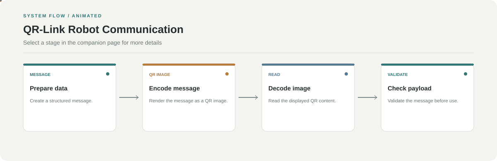

# QR-Link Robot Communication

**Transfer structured robot messages through a camera-readable QR link.**

[](https://github.com/chyk2468/qr-robot-communication)

## 1. Project Title & Tagline

Transfer structured robot messages through a camera-readable QR link.

## 2. Problem Statement

Some robot communication scenarios need an optical channel or a simple way to pass structured commands without relying on a continuous radio connection. This project encodes messages into QR images for decoding by a receiving side.

## 3. Project Preview

Add a short GIF or screenshot showing the current implementation and its main interaction.

[Open interactive architecture](architecture.html)

## 4. Overview

The project is organised as a sequence of input, processing, and result stages. The workflow diagram gives a high-level view of how the parts connect.

## 5. Key Features

- Encode structured payloads as QR codes.
- Read QR content from camera frames.
- Validate decoded message structure.
- Route valid messages to the relevant handler.

## 6. Architecture / Workflow



Open the [interactive architecture explorer](architecture.html) to select a stage and inspect its role.

## 7. Tech Stack

Python, QR-code utilities, OpenCV, and the message-handling code in the repository

## 8. Installation & Setup

```bash
git clone https://github.com/chyk2468/qr-robot-communication.git
cd qr-robot-communication
```

Install the dependencies required by the source files and configure the camera or display setup.

## 9. Usage

Run the sender and receiver according to the repository instructions, test with harmless sample messages, and validate payload structure before routing a command to a robot.

## 10. Project Structure

Inspect the message encoder, QR generation, camera capture and decoding, payload validation, and receiver handler modules.

## 11. Results & Demo

Add a demo showing encoded QR data, successful decoding, and rejected invalid messages. Report decode success rate and latency under tested lighting and distance.

## 12. Future Enhancements

- Add message versioning and integrity checks.
- Reject stale or duplicate commands.
- Measure reliability across distance and lighting.
- Add safety checks before robot actions.

## 13. License

Check the code and dependencies for licence requirements. Do not execute decoded commands without validation.
